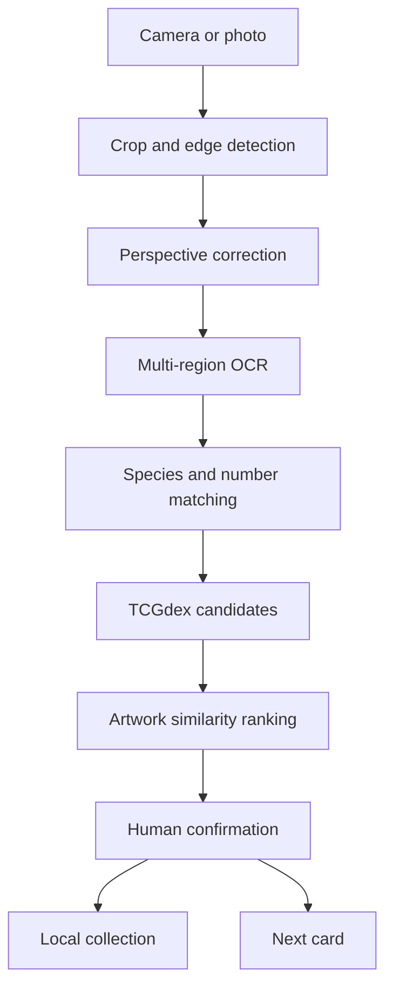

<div align="center">

# ✦ PokéVault Infinity

**Your collection. Your legacy. Beyond legendary.**

A cinematic, mobile-first Pokémon trading card collection tracker.

[](https://rstevens-dev.github.io/Poke-card-tracker/)
[](https://pages.github.com/)
[](https://tcgdex.dev/)


*An unofficial fan project. No account or API key required.*

</div>

## Enter the vault

**[Open the live app →](https://rstevens-dev.github.io/Poke-card-tracker/)**

Choose **Enter demo vault** to explore a sample collection without changing your own inventory. The demo begins with vintage cards and expands from ten catalog sets when the API is available. Demo prices are illustrative.

## Features

| Experience | Capabilities |
| --- | --- |
| Legendary interface | Cinematic entrance, animated hero, floating cards, holographic tilt, selectable themes |
| Digital binder | Search, quantities, conditions, wishlist, paginated collection |
| Market intelligence | Saved price estimates, cost basis, estimated gain/loss, trade calculator |
| Collector progression | XP, levels, achievements, set completion, approximate species tracking |
| Museum | Curated gallery of valuable cards |
| Pack chamber | Five-card simulated booster reveals; no real inventory changes |
| Scan Lab | Camera, upload, crop, rotation, edge detection, perspective correction, OCR, candidate artwork ranking |
| Batch scanning | Session count, confirm-and-add, next-card workflow |
| Mobile & offline | Responsive interface, PWA manifest, service worker, local inventory |
| Data portability | JSON export and import |

## Scan Lab: how to scan

1. Open **Scan card photo** and choose **Open camera** or **Upload photo**.
2. Align a single card inside the portrait guide. Use diffuse lighting and avoid foil glare.
3. Capture the card. Camera captures start recognition automatically; uploaded photos can be rotated or cropped first.
4. The scanner attempts to detect a quadrilateral and correct perspective using OpenCV.js. Use **Auto straighten** to retry.
5. OCR suggests a Pokémon name and collector number. Catalog candidates are ranked using number matching and lightweight image comparison.
6. Compare the candidate artwork and number before selecting **Confirm + add**.
7. With batch mode enabled, choose **Scan next card** to return to the camera.

If recognition fails, expand manual search, enter the Pokémon name and collector number, and select the correct artwork. The scanner does not authenticate cards, grade condition, or guarantee identification.

### Recognition architecture



Artwork comparison is a lightweight RGB thumbnail heuristic, not a trained image recognition model. It ranks retrieved candidates rather than searching every Pokémon card visually. Cross-origin image restrictions may prevent comparisons; text matching remains available. OpenCV and OCR are downloaded on demand. Vibration depends on browser/device support (notably limited on iOS).

## Technology

| Component | Purpose |
| --- | --- |
| HTML, CSS, JavaScript | Static application, animations and UI |
| [TCGdex](https://tcgdex.dev/) | Card catalog, images, sets and available prices |
| [PokéAPI](https://pokeapi.co/) | Species dictionary and Pokémon artwork |
| [Tesseract.js](https://tesseract.projectnaptha.com/) | Browser-based OCR |
| [OpenCV.js](https://docs.opencv.org/4.x/d5/d10/tutorial_js_root.html) | Edge detection and perspective transforms |
| Canvas | Image preprocessing and candidate comparison |
| localStorage | Personal inventory and preferences |
| Service worker | Offline application shell |
| GitHub Pages | Static hosting |

## Run locally

No build step or package installation is required.

```bash
git clone https://github.com/RStevens-dev/Poke-card-tracker.git
cd Poke-card-tracker
python -m http.server 8000
```

Open http://localhost:8000. Camera access requires a secure context (HTTPS or localhost).

## Deploy to GitHub Pages

In repository **Settings → Pages**, choose **Deploy from a branch**, select **main** and **/ (root)**, then save. Wait for the deployment to complete.

## Privacy, pricing and limitations

- Personal collection data is stored in the current browser, not a cloud account. Export backups regularly.
- Photo recognition runs locally; catalog searches and library downloads use external services.
- Offline access covers the application shell and stored inventory, not the full card catalog.
- Market values are estimates, not appraisals. Coverage varies by card and variant.
- Demo values and simulated pack pulls are not real market quotes or official pull odds.
- Recognition requires manual confirmation; foil glare, background clutter and unusual layouts can reduce accuracy.
- No required paid API keys or subscriptions; external services remain subject to availability and terms.

## Roadmap

- [ ] Validate scanner on iOS Safari and Android Chrome with real card photos
- [ ] Improve card detection and visual matching with a larger benchmark dataset
- [ ] Add variant-aware inventory and graded card metadata
- [ ] Add historical price snapshots and collection charts
- [ ] Improve offline catalog caching and optional cloud sync

## Contributing

Open an issue with browser/device details, reproduction steps and expected behavior. For scanner bugs, include a non-sensitive sample photo if possible.

## Credits

Pokémon names, characters and card artwork belong to their respective rights holders. PokéVault Infinity is an unofficial personal collector project and is not affiliated with Nintendo, Creatures, GAME FREAK or The Pokémon Company.

Card data and images are provided by TCGdex; species information and artwork are sourced through PokéAPI.
